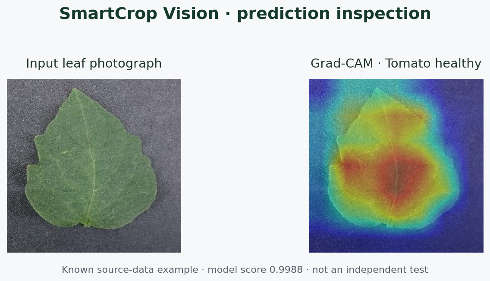
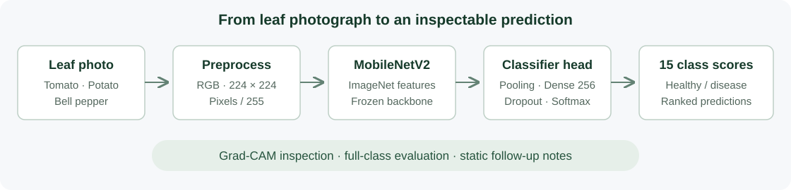

# SmartCrop Vision

**Plant leaf disease classification with explainable predictions and a reproducible evaluation workflow.**

[](https://github.com/MakenzieAhern/smartcrop-vision/actions/workflows/tests.yml)


SmartCrop Vision turns a leaf photograph into ranked predictions for **15 healthy/disease classes across tomato, potato, and bell pepper**. It combines a MobileNetV2 transfer-learning model with command-line inference, Grad-CAM visualizations, class-wise evaluation, and TensorFlow Lite export.

Built by **[Yuchen Deng](https://github.com/MakenzieAhern)**. I implemented the original project end to end—data preparation, model training, inference, evaluation, and visualization—within a university group-project context. This repository is a documented and retested portfolio edition. [Project provenance →](docs/PROVENANCE.md)

## At a glance

| Area | Implementation |
| --- | --- |
| Computer vision | ImageNet-pretrained MobileNetV2 with a custom 15-class head |
| Model size | 2,589,775 parameters; 224 × 224 RGB input |
| Inference | Validated class mapping, ranked predictions, static follow-up notes |
| Explainability | Grad-CAM through the nested, frozen backbone |
| Evaluation | Seeded sampling, full 15 × 15 confusion matrix, JSON and per-image results |
| Reproducibility | Pinned dependencies, duplicate-aware training split, saved manifests, automated tests |
| Deployment experiment | TensorFlow Lite export with float32 input/output |

## Try it in a few minutes

Use **Python 3.12**. The default trained model and one attributed example image are included; the full dataset is not required for this demo.

```bash
git clone https://github.com/MakenzieAhern/smartcrop-vision.git
cd smartcrop-vision
python3.12 -m venv .venv
source .venv/bin/activate           # Windows: .venv\Scripts\activate
python -m pip install -r requirements-dev.txt

python -m scripts.demo examples/tomato_healthy.jpg
python -m pytest -q
```

The included image produces:

```text
Tomato_healthy          0.9988
Tomato_Bacterial_spot   0.0006
Tomato__Target_Spot     0.0005
```

These are model scores from a **known source-data example**, not an independent test or a calibrated probability of disease. Follow-up notes are illustrative rules, separate from the learned classifier.

### Explain a prediction

```bash
python -m scripts.gradcam examples/tomato_healthy.jpg \
  --output outputs/gradcam.png
```



Grad-CAM highlights regions influencing the predicted class; it does not establish that the classification is correct.

## How it works



The original model was trained with inverse-frequency class weighting, augmentation, early stopping, learning-rate reduction, and validation-selected checkpoints. The supplied weights expect **`[0,1]` inputs**. Although MobileNetV2 commonly uses another preprocessing convention, changing this checkpoint's normalization would change its behavior.

The maintained training path separates augmented training images from unaugmented validation images, removes byte-identical duplicates before splitting, and saves the exact split and configuration. These changes apply to **new training runs**; the included checkpoints retain their original training provenance.

## Results and verification

**The project has been retested, but it does not yet have a genuinely independent field-image benchmark.** The verification record distinguishes software checks, current source-data evaluations, and historical validation results.

| Check run on 23 October 2026 | Verified result |
| --- | --- |
| Automated suite | **40 tests + 4 subtests passed** |
| 450-image source-data check, 15 classes | **90.67% accuracy · 0.9055 macro F1** |
| 90-image overlapping mini check | **84.44% accuracy** |
| Float32 TensorFlow Lite, 15-image parity check | **15/15 top-1 agreement · max score difference 3.52 × 10⁻⁶** |
| Training and notebooks | One-epoch synthetic training workflow and both CSV notebooks executed |

The sampled image checks use the original source corpus. They verify behavior on known-source data and **are not held-out generalization estimates**.

The original report records **87.80% validation accuracy and 0.8607 macro F1 on 3,089 images**. It used augmented validation data for checkpoint selection, and three exact duplicate pairs crossed the original train/validation split. The original `mini_eval` directory also overlaps entirely with the training corpus. These historical numbers should not be presented as independent test accuracy.

Read the [verification commands and evidence](docs/VERIFICATION.md), [data audit](docs/DATA_AUDIT.md), and [model card](docs/MODEL_CARD.md) for the scope and limitations of each result.

## Evaluate your own labeled images

Arrange images in subfolders named exactly as the labels in `class_indices.json`:

```text
my_evaluation/
  Tomato_healthy/
    leaf_001.jpg
  Potato___Early_blight/
    leaf_002.jpg
```

```bash
python -m scripts.eval_folder \
  --folder my_evaluation --per-class 0 --batch-size 32 \
  --output-dir outputs/my_evaluation

python -m scripts.plot_confusion_from_npy \
  --report-dir outputs/my_evaluation \
  --output outputs/my_evaluation/confusion_matrix.png
```

`--per-class 0` uses every image. Evaluation saves the full class confusion matrix, accuracy, F1 metrics, and individual predictions. Classes absent from the evaluation folder remain visible, so predictions into those classes are not silently discarded. The reported macro F1 explicitly averages all model classes.

A custom checkpoint can be passed with `--model path/to/model.keras --labels path/to/class_indices.json`. Supply only checkpoints you trust.

## Train a new model

Obtain a suitable dataset and follow the [data setup notes](docs/DATA.md). Then run:

```bash
python model_training_multiclass.py \
  --data-dir archive/PlantVillage \
  --epochs 12 --output-dir outputs/training
```

The ImageNet backbone weights are downloaded by Keras on first use. Keep the run's generated label map alongside its checkpoint. New split results are not directly comparable with the historical report. Exact-byte deduplication does not replace leaf/plant-group splitting.

`model_training.py` is a legacy command alias for the maintained training pipeline. `scripts/fine_tune.py` is a reserved stub: it exits with an explanation and writes no model because fine-tuning is not implemented.

## Export for TensorFlow Lite

```bash
python -m scripts.export_tflite --output outputs/smartcrop.tflite
```

The default export retains float32 weights and input/output, with the same image preprocessing. Experimental quantization (`--quantize`) is opt-in because it changed predictions in a small verification sample; see the verification record before using it. This is a conversion experiment, not a mobile performance claim.

## Repository guide

```text
scripts/                         Inference, evaluation, Grad-CAM, export, data audit
model_training_multiclass.py      Maintained transfer-learning training entry point
data_loader.py                   Dataset inventory and reproducible splitting
class_indices.json               Original checkpoint's class order
model_multiclass_final.keras      Default original trained checkpoint
checkpoints/                     Original validation-selected checkpoint
examples/                        Attributed inference sample and hash
reports/verification/            Fresh evaluation results and environment evidence
tests/                           Regression and model-tool tests
docs/                            Model card, data notes, audit, provenance, verification
.github/workflows/tests.yml      Automated checks on pushes and pull requests
```

The two Jupyter notebooks retain optional tabular-data exploration and cleaning. They are **not crop-yield prediction or crop-recommendation models**; the required original CSV files remain local and are documented in the data notes.

## Engineering lessons

- **Evaluation integrity:** detect exact duplicate leakage, separate historical validation from new checks, and retain errors into every output class.
- **Model contracts:** preserve class order, tensor shape, image normalization, and checkpoint identity across inference and export.
- **Reproducibility:** make scripts import-safe, provide stable CLI paths, record split manifests, and test real artifacts as well as edge cases.
- **Interpretation:** verify that gradients reach a frozen nested backbone and that generated overlays are valid image artifacts.

Next steps are a leaf-group-aware split, an independent field-photo evaluation, calibrated uncertainty, and measurements on an actual edge device.

## Attribution

The image data comes from a PlantVillage subset included with the original project. See the [PlantVillage authors' repository](https://github.com/spMohanty/PlantVillage-Dataset) and Mohanty, Hughes & Salathé's [2016 paper](https://doi.org/10.3389/fpls.2016.01419). TensorFlow/Keras and MobileNetV2 provide the modeling framework and pretrained backbone. Full source and asset notes are in [PROVENANCE.md](docs/PROVENANCE.md).
