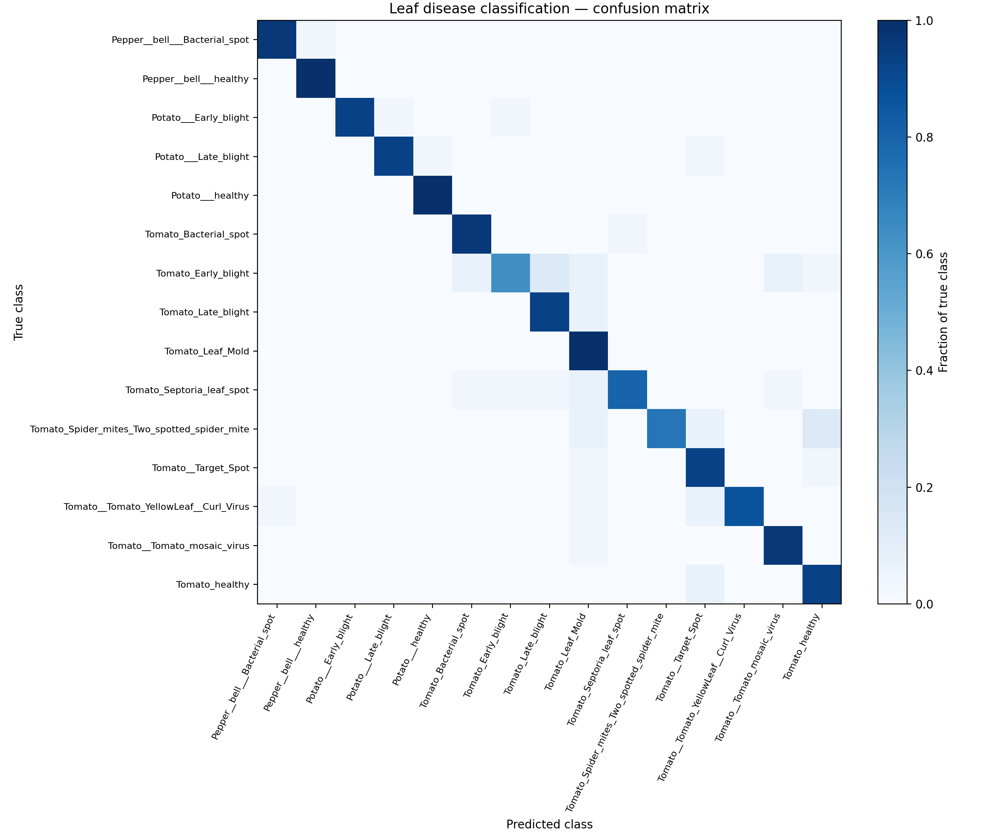

# Verification record — 23 October 2026

This record describes checks actually run during the portfolio maintenance pass. The supplied trained weights were not retrained on the full corpus. A one-epoch synthetic training run verifies the new training workflow only.

## Environment and checkpoint

Fresh Python **3.12.0** virtual environment on macOS/Apple Silicon, installed from `requirements-dev.txt`. See [environment.json](../reports/verification/environment.json) for direct dependency versions. The main regression suite passed **40 tests and 4 subtests**; warnings came from upstream dependency deprecations.

Default checkpoint SHA-256:

```text
b4d916b70e9a740a0290f2f83b0dc92366d7f69f7472edcbf7982a18fa07b035
```

The original default checkpoint is used for inference, current evaluation, explanations, and conversion. New evaluation uses PIL RGB conversion, nearest-neighbor resizing to 224 × 224, and float32 pixel / 255. Sampling sorts file paths before seeded selection (`seed=42`), unlike the original unsorted glob-based script.

## Observed results

| Check | Outcome | Interpretation |
| --- | --- | --- |
| Regression tests | 40 passed, 4 subtests passed | Data splitting, labels, preprocessing, inference, full-class evaluation, Grad-CAM, export, stub behavior |
| Included leaf demo | `Tomato_healthy`, score 0.9988 | Known source-data example |
| 15-class sampled evaluation | 408/450 correct; **90.67% accuracy**, **0.9055 macro F1** | 30 source images/class; not an independent holdout |
| Three-class mini evaluation | 76/90 correct; **84.44% accuracy** | 30 images/class; original mini directory overlaps the source corpus |
| Grad-CAM | Finite normalized 7 × 7 map, valid 224 × 224 overlay | Real checkpoint; direct-script execution also works outside repo cwd |
| Float32 TFLite | **15/15** top-1 agreement; max probability difference **3.52 × 10⁻⁶** | Conversion parity smoke on a small source-data sample |
| Experimental quantized TFLite | **14/15** agreement; max probability difference **0.32294** | Material drift; quantization is explicitly opt-in |
| Training workflow | One epoch, 8 synthetic images, 2 classes; checkpoint/report/manifest saved | Random frozen backbone, 6 train / 2 validation; no useful accuracy claim |
| Optional notebooks | Both executed successfully with original local CSVs | Overview and cleaning only; outputs kept local |

These source-data evaluations characterize behavior and confirm functionality. They cannot establish unseen-data performance or be compared directly with the historical 87.80% validation result. Source images may have been seen during training; historical model/report pairing is incompletely documented.

The mini report retains all 15 output classes. `macro_f1_all_classes` deliberately includes classes with no ground-truth examples; its value is not a three-class macro F1. Every prediction is retained in the confusion matrix.

## Evidence

- [All-class evaluation JSON, including per-image predictions](../reports/verification/all_classes/evaluation.json)
- [All-class text report](../reports/verification/all_classes/classification_report.txt)
- [Mini evaluation JSON](../reports/verification/mini_eval/evaluation.json)
- [Float32 export and Grad-CAM verification](../reports/verification/model_tools.json)
- [Quantized export comparison](../reports/verification/model_tools_quantized.json)
- [Data audit JSON](../reports/verification/data_audit.json)
- [Synthetic training smoke record](../reports/verification/training_smoke.json)



## Reproduction commands

From the repository root after installing dependencies:

```bash
python -m pytest -q
python -m scripts.demo examples/tomato_healthy.jpg
python -m scripts.gradcam examples/tomato_healthy.jpg --output outputs/gradcam.png
python -m scripts.export_tflite --output outputs/smartcrop.tflite
```

With the original local source dataset available:

```bash
python -m scripts.audit_dataset \
  --data-dir archive/PlantVillage --mini-dir mini_eval \
  --output outputs/data_audit.json

python -m scripts.eval_folder \
  --folder archive/PlantVillage --per-class 30 --batch-size 32 \
  --output-dir outputs/all_classes

python -m scripts.eval_folder \
  --folder mini_eval --per-class 30 --batch-size 32 \
  --output-dir outputs/mini_eval

python -m scripts.plot_confusion_from_npy \
  --report-dir outputs/all_classes --output outputs/confusion_matrix.png
```

To repeat the exact 15-image conversion comparison, the paths are stored in the verification JSON. After exporting the float32 model and restoring the original local mini dataset:

```python
import json
import numpy as np
import tensorflow as tf
from scripts.predict_one import preprocess

reference = json.load(open("reports/verification/model_tools.json"))
model = tf.keras.models.load_model("model_multiclass_final.keras", compile=False)
interpreter = tf.lite.Interpreter(model_path="outputs/smartcrop.tflite")
interpreter.allocate_tensors()
in_id = interpreter.get_input_details()[0]["index"]
out_id = interpreter.get_output_details()[0]["index"]
for sample in reference["samples"]:
    x = preprocess(sample["image"])
    expected = model(x, training=False).numpy()
    interpreter.set_tensor(in_id, x)
    interpreter.invoke()
    actual = interpreter.get_tensor(out_id)
    np.testing.assert_allclose(actual, expected, atol=2e-5, rtol=0)
    assert actual.argmax() == expected.argmax()
```

Floating-point differences can vary across hardware and dependency versions. This small parity check does not replace validation of all classes or measurements on the intended deployment device.

## Changes motivated by verification

- Fixed package/direct-script imports and asset paths independent of the current working directory.
- Unified preprocessing with the training image loader and validated label mappings, tensor shapes, and prediction values.
- Retained predictions into absent classes in all evaluation reports and confusion matrices.
- Fixed disconnected nested-backbone Grad-CAM and image dtype mixing.
- Used a SavedModel export bridge compatible with TensorFlow 2.17/Keras 3; made float32 the default after measuring quantization drift.
- Replaced the misleading no-training fine-tune script with a clear unsupported-operation message.
- Added main guards, duplicate-aware splits, deterministic seeds, unaugmented validation, and saved experiment manifests for new training.
